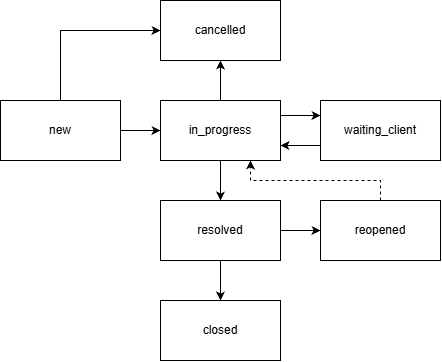

# CRM: дубли клиентов и модель обращений

## Поля обращения

| Поле | Что это |
|---|---|
| `id`, `number` | ID и человекочитаемый номер `TK-3000` |
| `client_id` | клиент |
| `channel` | откуда пришло: `email`, `phone`, `messenger`, `site_form`, `1c`, `manual` |
| `topic` | тема, примеры: доставка, накладная, наличие, цена, возврат, счёт, акт сверки |
| `status` | статус обращения |
| `priority` | `low`, `normal`, `high`, `critical` |
| `assignee_id` | ответственный менеджер |
| `sla_due_at` | дедлайн по SLA |
| `order_id` | связанный заказ, если есть |
| `doc_1c_ref` | номер/ID документа 1С (счёт, накладная) |
| `parent_ticket_id` | родительское обращение |
| `created_at`, `resolved_at`, `closed_at` | даты |

## Статусы и переходы

- `new` - обращение пришло.
- `in_progress` - менеджер взял в работу.
- `waiting_client` - ждём ответ клиента.
- `resolved` - решено, ждём подтверждения.
- `closed` - закрыто (автоматически через N времени после `resolved`).
- `reopened` - клиент вернулся, создаётся новый тикет со ссылкой на старый.
- `cancelled` - спам/дубль/ошибочно.

## Каналы

Email (парсер), телефон (оператор), мессенджер (webhook), форма на сайте, обмен с 1С, ручной ввод. В каждом канале клиент ищется через **один сервис** `ClientResolver` (см. ниже).

## SLA и эскалация

| Приоритет | Первый ответ | Решение |
|---|---|---|
| critical | 15 мин | 4 ч |
| high | 1 ч | 8 ч |
| normal | 4 ч | 24 ч |
| low | 8 ч | 72 ч |

- За 20% до дедлайна можно отправлять напоминание менеджеру.
- При просроченных ответах отправляем сообщения руководителю.

## Связи

- Обращение - **клиент** (главная карточка).
- Обращение - **заказ** (если вопрос по заказу).
- Обращение - **документ 1С** (счёт/накладная/ОРП) по номеру.

## Как не допустить новых дублей на входе

Создать один сервис создания клиента `ClientResolver`. Он сначала ищет по УНП, телефону, email, названию, потом создаёт. Сайт, 1С и ручной ввод работают через него. На входе проводится нормализация, валидация значений: УНП - только цифры (9), телефон - `375XXXXXXXXX` и так далее.
Можно периодически (например, раз в сутки) запускать cron-скрипт для определения дублей.